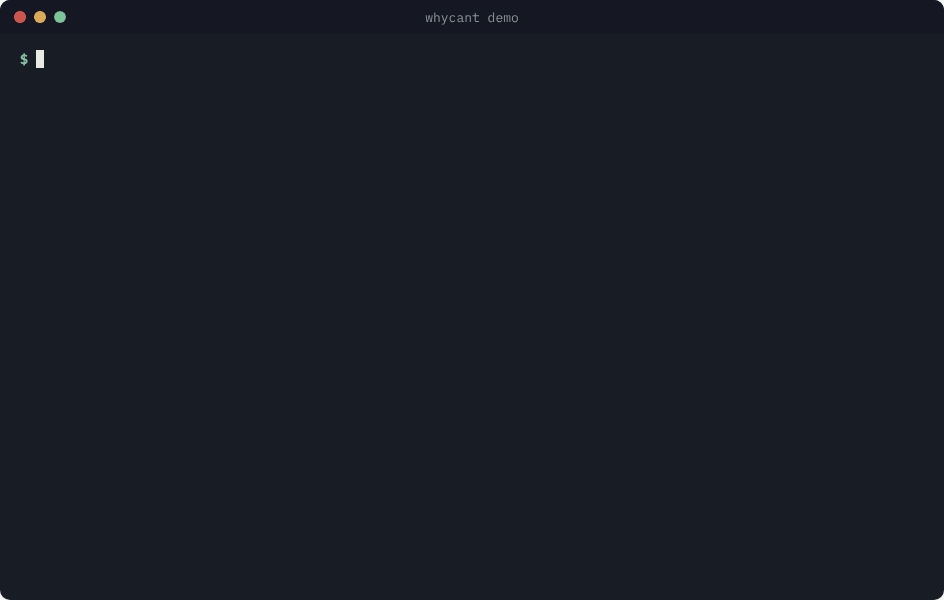

# whycant

[](https://github.com/Hennashakil/whycant/actions/workflows/ci.yml)
[](https://github.com/Hennashakil/whycant/actions/workflows/site.yml)
[](https://github.com/Hennashakil/whycant/releases/latest)
[](LICENSE)

**Website and live demo:** [hennashakil.github.io/whycant](https://hennashakil.github.io/whycant/)



**"Permission denied" tells you *that* access failed. `whycant` tells you *where*, *why*, and the *safest fix*.**

`whycant` is a small Linux command-line tool written in C. It walks a path one folder at a time, the same way the Linux kernel does, applies the kernel's permission rules at every step, and stops at the first one that blocks access. Then it explains the reason in plain English and suggests the narrowest fix — never `chmod 777`.

```
$ whycant -u bob team/f
Can bob (uid 30033) read team/f?

  [ ok ]  drwxr-xr-x  root:root   /srv/wtest       pass through needs x: as other you get r-x
  [DENY]  drwxr-x---  root:devs   /srv/wtest/team  pass through needs x: as other you get ---

  Why: bob is not the owner and not in group devs,
       so the 'other' bits apply, and they lack x.

  Narrowest fix first:
    1) setfacl -m u:bob:x /srv/wtest/team
       # only this user; needs the acl package
    2) usermod -aG devs bob
       # every member of the group; takes effect at next login
    3) chmod o+x /srv/wtest/team
       # every user on the system -- use only for public content
  Avoid chmod 777 and chmod -R: they open far more than this one step.

  => Denied.
```

## Install

**Option 1: Debian or Ubuntu package** (x86_64; includes the man page)

```bash
wget -N https://github.com/Hennashakil/whycant/releases/latest/download/SHA256SUMS
wget -N https://github.com/Hennashakil/whycant/releases/download/v1.1/whycant_1.1_amd64.deb
sha256sum -c --ignore-missing SHA256SUMS     # must say: OK
sudo apt install ./whycant_1.1_amd64.deb
```

Remove it with `sudo apt remove whycant`.

**Option 2: single binary** (any x86_64 Linux with glibc 2.34 or newer)

```bash
wget -N https://github.com/Hennashakil/whycant/releases/latest/download/whycant-linux-x86_64 \
     https://github.com/Hennashakil/whycant/releases/latest/download/SHA256SUMS
sha256sum -c --ignore-missing SHA256SUMS     # must say: OK
chmod +x whycant-linux-x86_64
sudo mv whycant-linux-x86_64 /usr/local/bin/whycant
```

**Option 3: build from source** (needs `gcc` and `make`)

```bash
git clone https://github.com/Hennashakil/whycant.git
cd whycant
make
sudo make install        # /usr/local/bin/whycant and its man page
```

Remove it with `sudo make uninstall`.

> **Upgrading from v1.0?** A copy in `/usr/local/bin` comes first in `PATH`, so it would hide the package. If you switch to the package, first run `sudo rm /usr/local/bin/whycant`, then check with `whycant --version`.

## Usage

```
whycant [OPTION]... [PATH]...
```

Both are optional. With no `PATH`, `whycant` checks the folder you are in.

| Command | Question it answers |
|---|---|
| `whycant` | Can I read the folder I am in? |
| `whycant /etc/hosts` | Can I read this file? |
| `whycant -w notes.txt` | Can I edit it? |
| `whycant -x ./backup.sh` | Can I run it? |
| `whycant -c /opt/myapp` | Can I create it (mkdir, touch)? |
| `sudo whycant -u www-data /var/www/html` | Can another user access it? |
| `whycant --json -w notes.txt` | The same answer as JSON, for scripts |

**Exit codes:** `0` allowed · `1` denied · `2` error — so it works in scripts and CI.

Full manual: `man whycant`

### JSON output

`--json` prints one JSON object per path, one per line ([JSON Lines](https://jsonlines.org/)):

```bash
$ whycant --json -u bob /srv/ex/team/report.txt | jq '{result, why, fix: .fixes[0].command}'
{
  "result": "denied",
  "why": "bob is not the owner and not in group devs, so the 'other' bits apply, and they lack x.",
  "fix": "setfacl -m u:bob:x /srv/ex/team"
}
```

| Field | Meaning |
|---|---|
| `user`, `uid`, `path`, `access` | The question: who, where, and `r`/`w`/`x` or `create` |
| `result` | `allowed`, `denied` or `error` |
| `steps[]` | Every folder on the way: `path`, `mode`, `owner`, `group`, `needs`, `class` (root, owner, named user, group, other), `gets`, `ok` |
| `why`, `note` | The reason in plain words |
| `fixes[]` | `{command, scope}`, narrowest first; every word is already shell-quoted |
| `stop` | Present instead of fixes for files that are closed on purpose |
| `problem`, `sudo_command`, `error` | When the walk could not finish, and how to look further |

### ACLs

Files with a `+` after their mode (`-rw-r-----+`) carry a POSIX ACL. whycant reads it and decides exactly like the kernel: named users, then the owning group and named groups, all limited by the ACL **mask**. When the mask is what blocks, it says so and suggests raising the mask instead of another entry:

```
  [DENY]  -rw-r-----+ root:root   /srv/shared/plan.txt  access needs w: ACL user:bob gives r-- after the mask

  Why: an ACL entry for bob (user:bob) decides here, and the ACL mask removes the bits it would allow.

  Narrowest fix first:
    1) setfacl -m m::rw /srv/shared/plan.txt
```

## Safety guards

`whycant` only reads; it never changes a file. On top of that:

- **Protected files.** Password, key and admin files (`/etc/shadow`, `/etc/sudoers`, SSH keys, `/root`, ...) get a **Stop** instead of a fix.
- **Root-level groups.** It never suggests joining `docker`, `disk`, `sudo`, `wheel`, `lxd`, `libvirt`, `kmem` or `shadow`, because membership in these is as good as root. Raw disks are blocked too.
- **Root only when needed.** It runs without `sudo`. If it truly cannot see further, it prints the exact `sudo` command to run — and under `sudo` it still checks for *you*, not for root (use `-u root` to check root itself).

## How it works

For each folder on the way, the user needs **x** (permission to pass through). At the destination, they need exactly what was asked: **r**, **w** or **x**. At every step, Linux asks four questions and **the first match wins**:

1. Is the user root? → allowed (except running a file with no x bit)
2. Does the user own it? → use the **owner** bits only
3. Does the file have an ACL entry for this user or one of their groups? → that entry, limited by the mask
4. Is the user in its group? → use the **group** bits only
5. Otherwise → use the **other** bits

Rule 2 surprises many people: if you own a file but the owner bits are empty, Linux never falls back to the group or other bits.

Also handled: symlinks (up to 40, like the kernel), `.` and `..`, trailing slashes, read-only and `noexec` mounts, and file names containing quotes or newlines.

## Testing

Every push runs these checks on GitHub Actions:

| Check | What it proves |
|---|---|
| Build with gcc and clang, warnings as errors | The code compiles cleanly on both compilers |
| Kernel comparison (`tests/kernel_check.sh`) | For 5 users × 49 paths (including ACLs) × read/write/run, plus 13 create cases (800 checks), whycant's answer matches the kernel's own decision: symlinks, loops, `..`, read-only and `noexec` mounts, odd file names |
| The same comparison under AddressSanitizer and UBSan | No memory errors or undefined behaviour along the way |
| Website browser tests (`tests/site/site.spec.js`) | On desktop, phone and dark mode: the switches, demo, quiz, playground, copy buttons and live GitHub status all work, with no JavaScript errors and zero [axe](https://github.com/dequelabs/axe-core) accessibility violations |
| Website engine vs the kernel (`tests/site/engine_check.py`) | The website's rules (`docs/engine.js`) give the kernel's answer for 2000 random paths |

Run them yourself:

```bash
make test                 # quick checks, no root needed
sudo make kernel-test     # full kernel comparison (creates and removes test users)

cd tests/site && npm ci && npx playwright install chromium
npx playwright test                       # website in a real browser
sudo env "PATH=$PATH" python3 engine_check.py   # website rules vs the kernel
```

Releases are automatic: pushing a tag such as `v1.1` builds the hardened binary and the `.deb` on Ubuntu 22.04, tests them, and publishes them with `SHA256SUMS` ([release.yml](.github/workflows/release.yml)).

## Website

The site in [`docs/`](docs/) is plain HTML, CSS and JavaScript with no build step and no trackers:

| File | What it holds |
|---|---|
| `index.html` | The page: learn, try, install |
| `style.css` | Layout, light and dark mode |
| `engine.js` | The permission rules, the same ones `whycant.c` applies, with no page code so tests can run them |
| `app.js` | The interactive parts: switches, demo walk, quiz, playground, live GitHub status, comments |
| `fonts/` | IBM Plex, self-hosted (SIL Open Font License), so the page makes no requests to Google |

Lighthouse (October 2026): **Performance 99–100, Accessibility 100, Best Practices 100, SEO 100** on mobile and desktop.

## Limitations

- Capabilities other than full root, immutable attributes, SELinux, AppArmor and NFS rules such as `root_squash` are not modelled
- Linux only

## Background

Built while studying the source of GNU coreutils `mkdir.c`, following the same habits: small single-purpose functions, every system call checked, safe output for odd file names, and write errors reported instead of ignored.

## License

[MIT](LICENSE)
